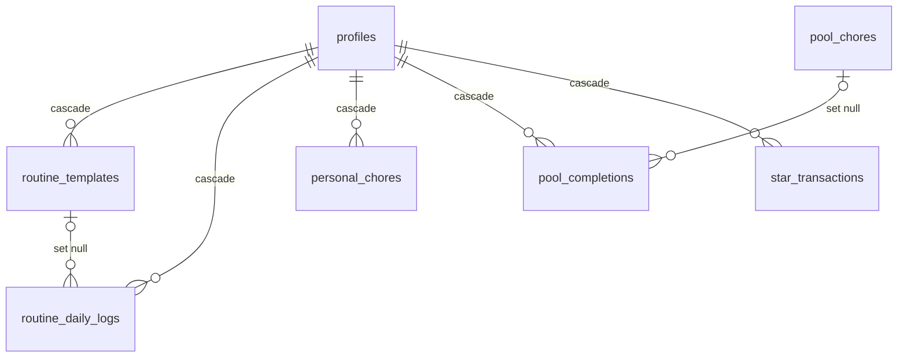

# eshnav — Architecture

Local-first Hebrew RTL family chore board (Skylight-style). One Node process serves the SPA and REST API on port 3000; data lives in one SQLite file. Product spec: [SPEC.md](SPEC.md).

## 1. Packages

| Package | Role | Key files |
| :--- | :--- | :--- |
| `@eshnav/shared` | Zod contracts, domain enums, theme tokens, Asia/Jerusalem time utils | `src/contracts.ts`, `src/themes.ts`, `src/time.ts` |
| `@eshnav/server` | Fastify API (M3), domain services (M2), Drizzle + better-sqlite3 | `src/db/schema.ts`, `src/db/connection.ts`, `drizzle/` |
| `@eshnav/web` | Vite + React 19 + Tailwind v4 SPA (M4/M5) | `index.html` (`lang="he" dir="rtl"`), `src/main.tsx` |

Dependency direction: `web → shared ← server`. `shared` has no runtime deps besides `zod`.

### Live types, no build in dev
`@eshnav/shared` exports a custom `development` condition pointing at `src/index.ts`:

```json
"exports": { ".": { "development": "./src/index.ts", "types": "./dist/index.d.ts", "default": "./dist/index.js" } }
```

- `tsc` typecheck uses `customConditions: ["development"]` (tsconfig.base.json) → source.
- Vitest / Vite dev resolve `development` by default → source. `tsx` gets `--conditions=development`.
- Production (`npm run build`): `tsconfig.build.json` sets `customConditions: []`, so the server compiles against `shared/dist`, and `node dist/index.js` loads `shared/dist/index.js`. Build order: shared → server → web (root `build` script).
- `drizzle-kit` cannot use the condition, so `npm run db:generate -w @eshnav/server` builds shared first.

## 2. Runtime

- `TZ=Asia/Jerusalem`, Node ≥ 22 (`.nvmrc`), idle RAM < 120 MB.
- `DB_PATH` default `./data/eshnav.db`; **relative paths resolve against the monorepo root** (`REPO_ROOT` in `connection.ts`), never the cwd. Production: `/var/lib/eshnav/eshnav.db`.
- `openDatabase()` creates the parent dir, applies pragmas on every connection, then runs pending Drizzle migrations from `packages/server/drizzle/` (ship that folder with the build):
  `journal_mode = WAL`, `synchronous = NORMAL`, `foreign_keys = ON`, `busy_timeout = 5000`.
- Single process, single connection; better-sqlite3 is synchronous, so every `db.transaction((tx) => …)` is atomic and serialized.

## 3. Time rules (`shared/src/time.ts`)

| Function | Rule |
| :--- | :--- |
| `getLogicalDateString(now)` | `Intl.DateTimeFormat('en-US', { timeZone: 'Asia/Jerusalem', hourCycle: 'h23' })`. **Never** `toISOString().slice(0, 10)` on wall-clock time. |
| `getJerusalemHour(now)` | Same formatter, 0–23 (midnight is 0). |
| `shiftLogicalDate(date, days)` | Synthetic UTC noon anchor `Date.UTC(y, m - 1, d, 12)` → DST-immune. |
| `getIsraeliDayOfWeek(date)` | 0 = Sunday … 6 = Saturday, from the noon anchor. |
| `getCurrentTimeWindow(now)` | `<12` MORNING, `<17` AFTERNOON, else EVENING. 00:00–04:59 maps to MORNING (the day's upcoming window). |
| `isTimeWindowElapsed(w, date, now)` | Past date → true; future → false; today → MORNING at ≥12, AFTERNOON at ≥17, EVENING never. |

Services take `now: number` (ms) as a parameter for deterministic tests; only transport code reads `Date.now()`.

## 4. Data model



`app_settings` is a standalone singleton. Columns use the spec's camelCase names; tables are snake_case. Timestamps are Unix ms integers; logical dates are `YYYY-MM-DD` text (lexicographic order = chronological).

### Constraints
- `app_settings`: `CHECK (id = 1)`. The row is **not** created by the migration (it needs a PIN hash) — seed / boot must insert it (M2/M3).
- `personal_chores.stars >= 0`, `pool_chores.stars >= 0`, `pool_chores.cooldownMinutes > 0`.
- `UNIQUE (routineId, logicalDate)` on `routine_daily_logs` → `runDailyRollover` uses `.onConflictDoNothing()` and is idempotent. (Rows whose template was deleted have `routineId = NULL` and no longer collide.)
- Enum columns (`pastelTheme`, `timeWindow`, `timeWindowSnapshot`, `status`, `resetMode`, `sourceType`) carry `CHECK (col IN (…))` generated from the shared enum tuples.
- History snapshots (`titleSnapshot`, `iconEmojiSnapshot`, `timeWindowSnapshot`) survive template deletion via `ON DELETE SET NULL`.

### Indexes (access-pattern driven)
| Index | Serves |
| :--- | :--- |
| `routine_daily_logs (profileId, logicalDate)` | board/history per child per day; profile cascade |
| `routine_daily_logs (logicalDate)` | rollover + history across all children |
| `pool_completions (profileId, logicalDate)`, `(logicalDate)` | drawer + history |
| `star_transactions (profileId, logicalDate)`, `(logicalDate)` | balance `SUM` per child, stars earned per day |
| `routine_templates (profileId)` | board load; cascade |
| `personal_chores (profileId, status)` | pending chores per child |

### Star ledger
`star_transactions` is append-only. `totalStars = SUM(starsDelta) WHERE profileId = ?`. Corrections are compensating rows (`UNDO`, `PARENT_ADJUSTMENT`), never updates. `sourceId` is intentionally not an FK (ledger outlives its sources). `starsEarnedThatDay = SUM(starsDelta)` for that `logicalDate` with `sourceType IN ('PERSONAL_CHORE','POOL_CHORE','UNDO')` (parent adjustments excluded).

## 5. Transaction boundaries (M2 services)

All multi-table writes run in one synchronous `db.transaction((tx) => …)`. Routes and components never touch the DB.

| Operation | Writes inside one transaction |
| :--- | :--- |
| Complete routine (today) | insert `routine_daily_logs` `COMPLETED` (snapshot + `completedAt`) |
| Uncheck routine (today) | delete today's `COMPLETED` log row |
| Complete personal chore | `status=COMPLETED`, `completedDate`, `completedAt`; if `stars > 0` insert `+stars` `PERSONAL_CHORE` |
| Uncheck personal chore | `status=PENDING`, clear dates; if `stars > 0` insert `-stars` `UNDO` |
| Complete pool chore | reject (409) if `!isActive` or `now < cooldownEndsAt`; insert `pool_completions`; insert `+stars` `POOL_CHORE` (sourceId = completion id); `lastCompletedAt = now`; COOLDOWN → `cooldownEndsAt = now + cooldownMinutes·60 000`; AUTO_DISABLE → `isActive = false`, `cooldownEndsAt = null` |
| Undo pool completion | delete completion; insert `-starsAwarded` `UNDO`; `cooldownEndsAt = null`; AUTO_DISABLE → `isActive = true` |
| Daily rollover(D) | for each active template scheduled on `getIsraeliDayOfWeek(D)` without a log for D: insert `MISSED` snapshot, `.onConflictDoNothing()` |
| Toggle past routine | upsert log for (routineId, D < today): `COMPLETED ↔ MISSED` (set/clear `completedAt`) |
| Parent star adjustment | insert `PARENT_ADJUSTMENT` row |

Rollover runs at 00:00 Asia/Jerusalem and on boot for every unsealed past date (catch-up).

## 6. Ring calculation

Per child, per `logicalDate`, per window `w`:
- `scheduled` = active templates of the child with `w` and day-of-week of the date (today) — or, for past dates, the logged rows for that date (snapshots) plus scheduled templates without a row (not yet sealed).
- `completedCount` = scheduled with a `COMPLETED` log.
- `isWindowElapsed = isTimeWindowElapsed(w, date, now)`.
- unfinished = `totalScheduled − completedCount` → goes to `redMissedCount` if elapsed, else `greyRemainingCount` (never both).
- Colors (`RING_COLORS`): green `#10B981` completed, grey `#E5E7EB` remaining, rose `#F43F5E` missed.
- Celebration: `completedCount === totalScheduled && totalScheduled > 0` for the selected window.

## 7. API conventions (`shared/src/contracts.ts`)

- Base path `/api/v1`, JSON, relative URLs from the SPA (single origin).
- Success: resource or bare array; `201` on pool completion create and admin creates; `204` on deletes.
- Errors: `{ error: { code, message } }` — `VALIDATION_ERROR` 400, `UNAUTHORIZED`/`INVALID_PIN` 401, `NOT_FOUND` 404, `CONFLICT` 409, `RATE_LIMITED` 429, `INTERNAL_ERROR` 500.
- Request bodies are strict objects (unknown keys → 400). Create bodies apply defaults; PATCH bodies never do and must contain ≥ 1 field.
- `PATCH /admin/pool-chores/:id/toggle-active` takes an explicit `{ isActive }` so double taps are idempotent.
- Board `completedToday` and history `chores` are discriminated unions on `kind` (`ROUTINE` | `PERSONAL_CHORE` | `POOL_COMPLETION`); `id` is the key the matching undo endpoint expects.

| Endpoint | Request | Response |
| :--- | :--- | :--- |
| `GET /board` | — | `BoardResponse` |
| `POST /routines/:id/toggle` | `IdParams` | `RoutineToggleResponse` |
| `POST /personal-chores/:id/toggle` | `IdParams` | `PersonalChoreToggleResponse` |
| `POST /pool-chores/:id/complete` | `CompletePoolChoreBody` | `CompletePoolChoreResponse` (201) |
| `POST /pool-completions/:id/undo` | `IdParams` | `UndoPoolCompletionResponse` |
| `GET /history?date=` | `HistoryQuery` | `HistoryResponse` |
| `POST /admin/unlock` · `/admin/lock` | `UnlockBody` · — | `AdminSessionResponse` |
| `PATCH /admin/settings` | `UpdateSettingsBody` | `PublicSettings` |
| `GET/POST/PATCH/DELETE /admin/profiles[/:id]` | `CreateProfileBody` / `UpdateProfileBody` | `Profile` / `Profile[]` |
| `POST /admin/profiles/:id/adjust-stars` | `AdjustStarsBody` | `AdjustStarsResponse` |
| `GET/POST/PATCH/DELETE /admin/routines[/:id]` | `CreateRoutineBody` / `UpdateRoutineBody` | `RoutineTemplate` |
| `GET/POST/PATCH/DELETE /admin/personal-chores[/:id]` | `CreatePersonalChoreBody` / `UpdatePersonalChoreBody` | `PersonalChore` |
| `GET/POST/PATCH/DELETE /admin/pool-chores[/:id]` | `CreatePoolChoreBody` / `UpdatePoolChoreBody` | `PoolChore` |
| `PATCH /admin/pool-chores/:id/toggle-active` | `TogglePoolChoreActiveBody` | `PoolChore` |
| `POST /admin/pool-chores/:id/reset-cooldown` | — | `PoolChore` |
| `POST /admin/history/toggle-routine` | `ToggleHistoryRoutineBody` | `ToggleHistoryRoutineResponse` |

Routines are exposed as `daysOfWeek: DayOfWeek[]`; the DB column `daysOfWeekJson` is a Drizzle `text({ mode: 'json' })` so services pass arrays directly.

## 8. Security

- Board, kid actions and history reads are public (LAN / tunnel). Everything under `/admin/*` except `unlock` requires the signed `eshnav_admin_session` HTTP-only cookie (`requireParentAdmin`).
- PIN stored as salted scrypt hash. Unlock must be rate-limited (4-digit PIN = 10 000 combinations).
- `NODE_ENV=production` fails fast without `SESSION_SECRET` (≥ 32 chars).
- `PublicSettings` never contains `parentPinHash`. `avatarImageUrl` accepts only `http(s)` URLs.
- Frontend auto-relocks after 5 minutes of inactivity.
